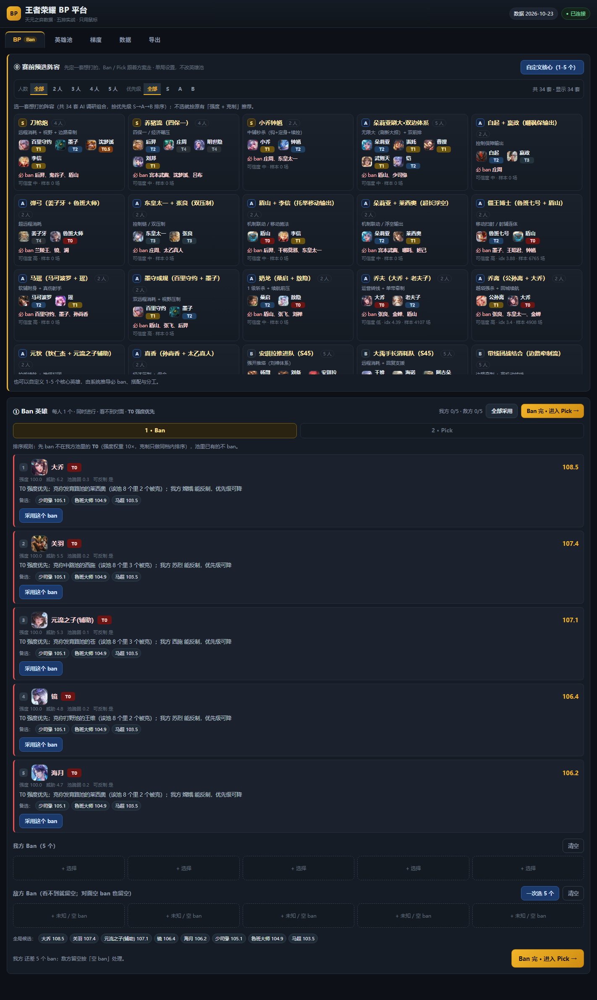
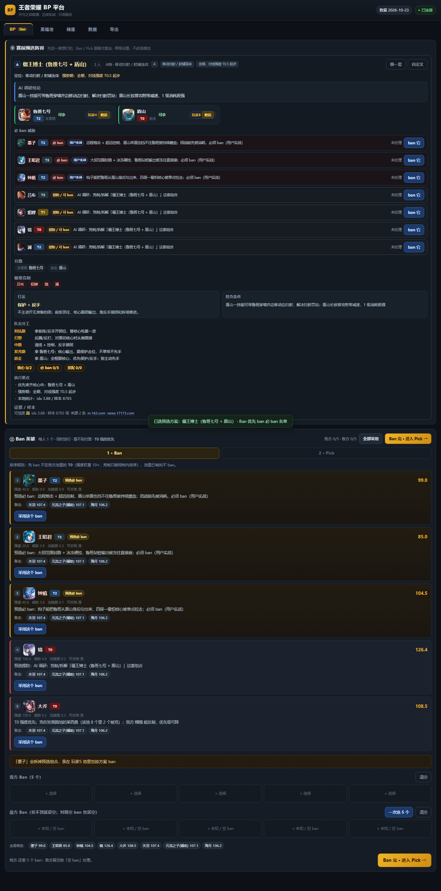
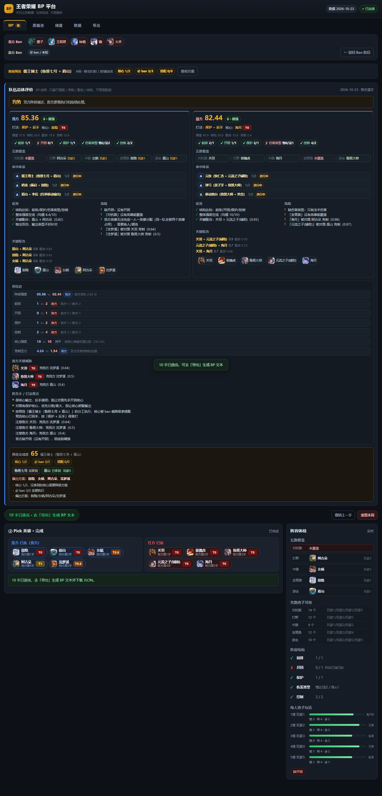
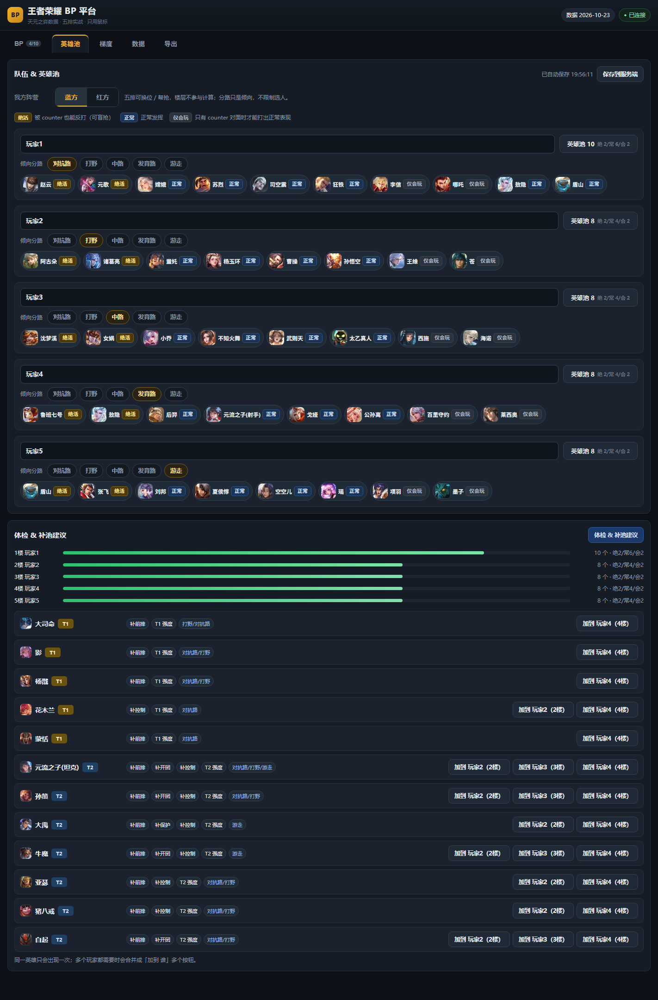

# Honor of Kings (HOK) Five-Stack BP Platform (Honor of Kings BP Assistant)

[中文](README.md) ｜ **English**

[](https://nodejs.org/)
[](#quick-start)
[](#tests)
[](LICENSE)
[](data/snapshot)

> **A BP assistant for five-stack ranked play: local, zero-dependency, driven entirely by the mouse.**
> It only computes hero strength / counters / synergy / lineup structure — **it does not predict win rates, does not touch any in-game factor, and does not connect to the game client.**

A BP panel for a five-stack team to use in the 5 minutes before a match: fill in the five players' hero pools once, and from then on every game runs
**pre-select lineup → 10 bans → 1-2-2-2-2-1 picks → post-match team review**, ending with a BP text you can review afterwards.

| Ban phase (one instruction + fallbacks per player) | Pre-match pre-select lineup (34 combos) |
|---|---|
|  |  |

| Post-match team review | Hero-pool checkup & pool-fill advice |
|---|---|
|  |  |

---

## Table of Contents

- [What This Is](#what-this-is)
- [Core Features](#core-features)
- [Quick Start](#quick-start)
- [Usage Flow](#usage-flow)
- [Scoring Rules](#scoring-rules)
- [Data Sources & Boundaries](#data-sources--boundaries)
- [Repository Layout](#repository-layout)
- [Tests](#tests)
- [Data Updates & Extending](#data-updates--extending)
- [Known Limitations](#known-limitations)
- [License & Credits](#license--credits)

---

## What This Is

In Honor of Kings five-stack ranked play, BP usually comes down to one person's gut feeling. This platform turns "who should ban whom, who should we grab this turn, who plays which hero" into explainable scores:

- **Ban**: 10 ban slots, 1 per player, banned blindly and simultaneously (you cannot see the opponent). Each one gives you "ban whom + why + whom to switch to if a teammate bans him first".
- **Pick**: runs in 1-2-2-2-2-1 order, split into three phases by our pick position — grab / reinforce / counter — with candidates drawn from the union of the whole team's hero pools.
- **Division of labour**: the engine uses bipartite matching to guarantee "each of the 5 players plays one hero"; candidate cards and picked cards both state who plays it and at what mastery, and you can also assign manually.
- **Review**: once the 10th pick is in, both teams get an overall review (score / structure / core / synergy / risk / matchups) plus pre-select completion.

The boundary is explicit: **lineup layer only**. No win-rate prediction, no lane-matchup strength, no item builds, no reading game memory, no game API integration.

## Core Features

| Capability | Description |
|---|---|
| Pre-match pre-select lineup | Pick one of 34 hand-researched strong combos (or define 1-5 custom core heroes); bans prioritize breaking the must-ban pieces first, picks prioritize taking the core and its partners; split into `must` (mandatory in real play) and `watch` (breakpoints identified by research) |
| Strength-driven Ban | T0 always ranks ahead of T1, and counters only order heroes within the same tier; heroes in our own pools are never banned; apply everything with one click or click slots one by one |
| Phased Pick | Picks 1-2 ("grab") barely look at counters, pick 3 "reinforces", picks 4-5 ("counter") target the opponent's core (countering T0 pays the most) |
| One hero per player | Full bipartite matching (mastery-weighted, MRV tie-break) so "one player hoarding many heroes" cannot happen; manual assignment and revert-to-auto supported |
| Five-lane deduplication | Candidates only list heroes that can fill the still-open lanes; the restriction lifts once all five lanes are covered |
| Lineup checkup | Five-lane coverage, frontline / engage / protection / control / damage type, and each player's pool survival rate (best / normal / basic distribution) |
| Post-match review | Both teams' score and grade, the five structure items, core, synergy, risk, matched combo systems, matchup verdict and win condition |
| Offline data | All 133 hero icons, TianYuan snapshots and KPL collection results are local, so it works without a network |
| Zero dependencies | No `node_modules`: the server is `node:http`, the front end is vanilla JS (no framework, no build), and test scripts use Node's native `fetch` / `WebSocket` |

## Quick Start

All you need is **Node ≥ 22** (tested on v24.22.1); no `npm install` required.

```bash
git clone https://github.com/Fire-Phoenixs/honor-of-kings-bp-assistant.git
cd honor-of-kings-bp-assistant

# Optional: try the full flow with the demo hero pools (5 players, 8-9 heroes each)
cp data/store.sample.json data/store.json      # Windows: copy data\store.sample.json data\store.json

node server.mjs --port 3721 --open             # or double-click start.cmd / npm start
```

Then open <http://127.0.0.1:3721> in a browser.

> - If the port is taken, choose another one: `node server.mjs --port 3722`.
> - It only listens on `127.0.0.1`; to reach it from a phone or tablet on the same network, add `--host 0.0.0.0` (mind the security implications).
> - `data/store.json` is your local save file (hero pools / history). It is in `.gitignore` and will never be committed.

## Usage Flow

### ⓪ Fill the pools (5 minutes, once)

Go to the "Hero Pools" tab (`英雄池`): enter each player's name, click 1-2 **preferred lanes** (a prior only — it does not restrict picks), then click "Hero Pool N" (`英雄池 N`) to open the picker and choose heroes; once a hero is in the pool, set its mastery:

- **Best** (`绝活`, "signature"): can fight back even when countered → the penalty is discounted, safe to blind-pick;
- **Normal** (`正常`, "solid"): normal performance;
- **Basic** (`仅会玩`, "can-only-play"): only performs normally when countering the opponent → the countered penalty is amplified.

Changes are saved automatically; "Checkup & pool-fill advice" (`体检 & 补池建议`) reports pool depth, mastery distribution, five-lane coverage and the heroes you could add (each hero appears only once).

### ① Pre-select lineup (optional, 30 seconds)

Filter the 34 combos by size (2/3/4/5) and priority (S/A/B); click one to select it and the card spells out its core, type, must-bans, confidence and sources. Once selected, it shows the division of labour and how complete the combo is; you can also use "Custom core" (`自定义核心`) to let the system derive the must-bans and partners. Skip it and the engine falls back to the plain "strength + counter" recommendation.

### ② Ban (10 bans)

Entering the BP page first shows only the Ban panel, handing you 5 execution instructions at a time:

```
Bao / Clash lane → Hai Yue (T0) 128.4
  T0 strength first; not in any of our pools
  Fallbacks: Guan Yu (T0) 118.2 / Da Qiao (T0) 117.6
```

Click "Apply this ban" (`采用这个 ban`) or "Apply all" (`全部采用`), or click slots by hand to change them; enemy bans can be entered 5 at a time, and leaving them all empty means the opponent banned nothing. When done, click "Ban done · go to Pick →" (`Ban 完 · 进入 Pick →`).

### ③ Pick (1-2-2-2-2-1)

A fixed ban-icon strip for both sides stays pinned at the top (you can go back and fill in what is missing); the turn banner states which of our picks it is plus the phase; every candidate card carries a score breakdown (strength / counter / countered / synergy / coverage / lane fill / mastery) and a reason, and says "who plays it: name (mastery)". On the opponent's turn, click their hero to record it, or skip. A lineup checkup panel sits permanently on the right.

### ④ Post-match review + export

Once the 10th pick is in, the "Team review" (`队伍总体评价`) panel appears: both teams' score/grade, the five structure items, core, synergy, risk, matched systems, matchup verdict and win condition, and pre-select completion. The export page generates the full BP text for the game (recommendation + actual pick + eligible players + mastery); it can be copied, downloaded as JSON, and is written to `history` in `data/store.json`.

> Screenshots: see [`docs/screenshots/`](docs/screenshots).

## Scoring Rules

> Every score is an **explainable weighted sum**, not a black-box model; the weights live under `weights` in `data/meta.json` and are tunable.

**Ban (strength-driven since v2.1)**

- Ban the **T0** heroes that are in none of our pools first (strength weight 10×); T0 always ranks ahead of T1;
- Counters are only used to order heroes **within the same tier**; heroes in our pools are not banned (unless the pre-select lists them as `must`);
- Pre-select `must` entries are forced to the front, while `watch` adds a small weight without outranking T0.

**Pick (v2.5: tier does not decide games)**

- Picks 1-2 ("grab") weigh strength only; pick 3 "reinforces"; picks 4-5 ("counter") specifically counter the opponent's core;
- Based on 1323 KPL games: T0 and T2 differ by only 2.1 points of win rate, while "almost never countered 55.1% → heavily countered 49.4%" differs by 5.7 points — so the grab phase lowers the tier weight and raises the counter and countered penalties;
- **Solo value and combo value are kept separate**: a hero's standalone value is decided only by solo signals such as tier / ban rate, while combo value is settled only once the pieces are assembled (completing an S-tier combo yields a completion bonus) and is never spread across individual heroes.

**One hero per player (v2.3)**

- Runs a full bipartite match over "our picks + candidates", optimizing by mastery (best 3 / normal 2 / basic 1) with MRV tie-breaking;
- Candidates additionally require `heroLanes ∩ open ≠ ∅`; a manual assignment acts as a hard constraint — if it is infeasible it is ignored with a warning.

The full field contract is in [`docs/engine-contract-v2.md`](docs/engine-contract-v2.md) and [`docs/feature-preset-review.md`](docs/feature-preset-review.md).

## Data Sources & Boundaries

| Data | Source | Use |
|---|---|---|
| Tiers T0~T4, win / pick / ban rates | [TianYuan](https://tianyuanzhiyi.com) public data (T-1 snapshot, `data/snapshot/`) | Solo strength and ban rate; can be overridden by hand in the UI |
| Counter / synergy | Also TianYuan match statistics (`advantageIndex` / `synergyIndex` + a sample-size threshold) | `src=stats` — these are not hand-written relationships |
| Strong combos (systems) | **Hand-researched**, 34 sets (`data/combos.json` + [combo & counter research notes](docs/强势组合与克制关系-调研.md)) | System-level statistics cannot express them (they only cover pairs), so they have to be filled in manually |
| Real KPL BP | Tencent's official esports API, 2026 Spring / Challenger Cup / Summer **1323 games** + 159 games of the year-end finals (`data/kpl-bp-*.json`) | **Referenced on a par with TianYuan**: ban score = TianYuan 55% + KPL 45% + strength 20% (`tools/integrate-data.mjs`) |
| Hero table / icons | Official `herolist.json` (`data/source/`) + TianYuan CDN icons (cached offline) | 133 heroes, a single data source |

- **No King's Camp (`王者营地`) integration**: its API requires a logged-in session, and this project does not attempt any bypass.
- **Copyright**: hero data, icons and esports data are copyright Tencent / TianYuan / the KPL organizers; this project is for personal study and personal use only, so **please do not redistribute the datasets**; the code itself is released under MIT (see [LICENSE](LICENSE)).
- **No win-rate prediction**: there is no reliable match sample, so any percentage would be made up.

## Repository Layout

```
honor-of-kings-bp-assistant/
├── server.mjs              Zero-dependency local server (node:http, 127.0.0.1:3721)
├── start.cmd               Windows double-click launcher
├── package.json            Provides npm scripts only (no dependencies)
├── web/
│   ├── index.html          Single-page entry (tabs: BP / Hero Pools / Tiers / Data / Export)
│   ├── engine.js           Decision engine (pure functions, CommonJS, require-able from Node for unit tests)
│   ├── app.js              Views and interaction (vanilla JS, no framework, no build)
│   ├── ai.js / style.css / heroicons.js / favicon.svg
│   └── icons/              133 hero icons (local, offline)
├── bp/data/heroes.js       133-hero master table (generated from the official table, front-end window.HEROES)
├── data/
│   ├── meta.json           Tiers / tags / weights (generated by build-meta.mjs)
│   ├── relations.json      Counters / synergies (including sample sizes)
│   ├── combos.json         34 strong combos (hand-researched)
│   ├── combo-bans.json     Must-bans added from real play
│   ├── integration-v1.json Three-way integration of TianYuan + KPL + combos
│   ├── kpl-bp-*.json       Raw and aggregated real KPL BP data
│   ├── snapshot/           Raw TianYuan snapshots (by date, read-only)
│   ├── source/             Official hero table (data source for heroes.js)
│   ├── research/           Raw research material behind combos and counters
│   ├── store.sample.json   Demo hero pools (5 players, 8-9 heroes each)
│   └── store.json          Your local save (created at runtime, not committed)
├── tools/                  Data build / collection / validation / tests (see below)
└── docs/                   API contracts, feature plans, research reports, screenshots
```

`tools/` at a glance:

| Script | Purpose |
|---|---|
| `fetch-tianyuan.mjs` | Fetch TianYuan's snapshot currently available (T-1) into `data/snapshot/<date>/` |
| `build-meta.mjs` | Snapshot → `meta.json` + `relations.json` |
| `validate-data.mjs` | Data consistency validation (usable only at 0 errors) |
| `fetch-icons.mjs` | Refresh hero icons (`--check` only validates) |
| `import-pools.mjs` | Import hero pools from a batch list (whole-pool replacement, with backup) |
| `collect-kpl-bp.mjs` / `analyze-kpl-bp.mjs` | Targeted collection from the official KPL API / statistics |
| `integrate-data.mjs` | Three-way integration → `integration-v1.json` (CONFIG sits at the top of the file) |
| `combos-probe.mjs` | Read-only detection of which combos the picked heroes already hit |
| `probe-render.mjs` | Generic headless Chrome + CDP page probe (for data on JS-rendered pages) |
| `test-engine.mjs` / `smoke.mjs` / `e2e.mjs` | The three test layers (see below) |

## Tests

```bash
node tools/test-engine.mjs    # engine unit tests: 45 cases
node tools/smoke.mjs          # syntax + data + server + engine smoke: 55 cases
node tools/validate-data.mjs  # data consistency (0 errors)
node tools/e2e.mjs            # browser E2E: 79 cases (headless Chrome, screenshots in .e2e/)
```

- The first three have zero dependencies and need no external services, so they run right after `clone` (when the real save file is missing they fall back to `data/store.sample.json`).
- `e2e.mjs` needs a local Chrome/Edge (point to it with `CHROME_PATH`) and **Node ≥ 22** (it drives CDP directly through the native `WebSocket`, no puppeteer); it starts a temporary server and restores `data/store.json` automatically when done.
- Suggested CI order: `validate-data` → `test-engine` → `smoke`.

## Data Updates & Extending

```bash
node tools/fetch-tianyuan.mjs   # 1. refresh the snapshot
node tools/build-meta.mjs       # 2. rebuild meta.json + relations.json
node tools/validate-data.mjs    # 3. validate
node tools/fetch-icons.mjs      # 4. add icons for new heroes / skins
```

Hard constraints when changing things (read [`docs/engine-contract-v2.md`](docs/engine-contract-v2.md) first):

- Changing the store structure requires updating all three of `engine.normalizeStore`, `validateStore` in `server.mjs`, and `tools/validate-data.mjs`;
- Changing the weight keys in `meta.json` requires updating `WEIGHT_KEYS` in both `tools/build-meta.mjs` and `tools/validate-data.mjs`;
- In the combo data (`combos.json`), `size` must equal `core.length`, and hero names must hit the tier keys in `meta.json`.

## Known Limitations

1. Tiers and counters refresh once a day (T-1) and do not reflect same-day hotfixes; the data date is visible in `/api/health` and at the top of the page.
2. Hero tags such as "frontline / engage / protection" are a first draft (`tagSource: draft`) and affect the lineup checkup and the pool-fill advice.
3. Blind bans are the expected optimum, not a guaranteed win; no win/loss prediction.
4. Pool-fill advice is rule-based (coverage + tier + relations + mastery) and is not connected to any external LLM.
5. Single user on the local machine only; sharing between people needs a separate deployment.

## License & Credits

- Code: [MIT](LICENSE).
- Data: TianYuan, Tencent's official *Honor of Kings* materials and KPL esports data remain the property of their respective owners; this project is for personal use only, so please do not redistribute the datasets.
- Combo and counter research: see [combo & counter research notes](docs/强势组合与克制关系-调研.md); related AI BP work (JueWuDraft / the JueWu AI coach and others) is listed in [AI BP related-work inventory](docs/调研-AI-BP相关作品清单.md).
