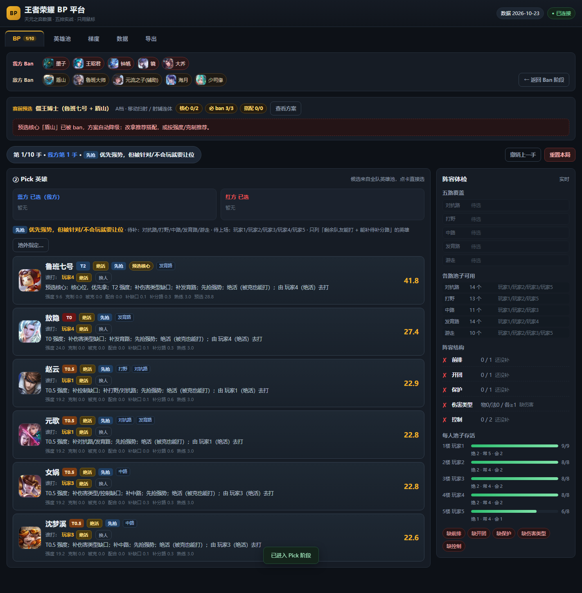
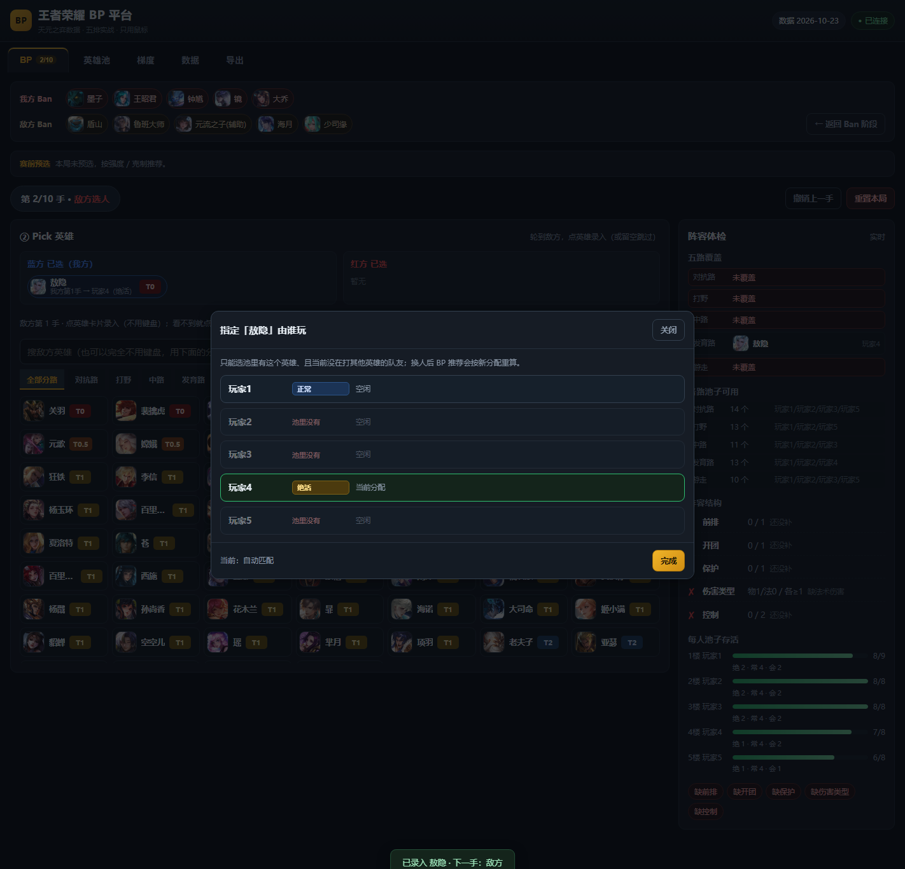

# 王者荣耀五排 BP 平台（Honor of Kings BP Assistant）

**中文** ｜ [English](README.en.md)

[](https://nodejs.org/)
[](#快速开始)
[](#测试)
[](LICENSE)
[](data/snapshot)

> **本地运行、零依赖、纯鼠标操作的五排排位 BP 助手。**
> 只算英雄强度 / 克制 / 配合 / 阵容结构，**不预测胜率、不涉及任何局内因素、不接游戏客户端**。

一套给五排车队赛前 5 分钟用的 BP 面板：填一次五人英雄池，之后每局按
**预选阵容 → 10 ban → 1-2-2-2-2-1 pick → 赛后队伍总评** 走完，最后给一份可复盘的 BP 文本。

| Ban 阶段（每人一条指令 + 备选） | Pick 阶段（分阶段推荐 + 谁打） |
|---|---|
|  |  |

| 赛前预选阵容（34 套组合） | 赛后队伍总体评价 |
|---|---|
|  |  |

| 英雄池体检 & 补池建议 | 手动指定谁打（一人一英雄） |
|---|---|
|  |  |

---

## 目录

- [这是什么](#这是什么)
- [核心特性](#核心特性)
- [快速开始](#快速开始)
- [使用流程](#使用流程)
- [算法口径](#算法口径)
- [数据来源与边界](#数据来源与边界)
- [目录结构](#目录结构)
- [测试](#测试)
- [数据更新与二次开发](#数据更新与二次开发)
- [已知限制](#已知限制)
- [许可与致谢](#许可与致谢)

---

## 这是什么

王者荣耀五排排位里，BP 往往靠一个人拍脑袋。这个平台把「谁该 ban 谁、这手该抢谁、谁打哪个英雄」变成可解释的评分：

- **Ban**：10 个 ban 位、每人 1 个、同时盲 ban（看不到对面）。每条给「ban 谁 + 为什么 + 队友先 ban 了他就改 ban 谁」。
- **Pick**：按 1-2-2-2-2-1 推进，按我方手位分「先抢 / 补强 / 克制」三阶段，候选来自全队英雄池并集。
- **分工**：引擎用二分图匹配保证「5 个人各玩一个英雄」，候选与已选卡都写清谁打、熟练度，也可以手动指定。
- **复盘**：10 手结束后给双方队伍总评（评分/结构/核心/配合/风险/对位）+ 预选完成度。

边界很明确：**只做阵容层**。不预测胜率、不算对线强弱、不写出装、不读游戏内存、不接任何游戏接口。

## 核心特性

| 能力 | 说明 |
|---|---|
| 赛前预选阵容 | 从 34 套人工调研的强势组合里选一套（或自定义 1-5 个核心），Ban 优先拆掉必 ban 位、Pick 优先拿核心与搭配；分 `must`（实战必备）与 `watch`（调研拆解点）两层 |
| 强度主导的 Ban | T0 永远排在 T1 前面，克制只做同档内排序；我方池里的英雄不 ban；可一键全部采用或逐条点槽位 |
| 分阶段 Pick | 第 1-2 手「先抢」几乎不看克制，第 3 手「补强」，第 4-5 手「克制」专打对面核心（克 T0 收益最高） |
| 一人一英雄 | 二分图完整匹配（熟练度加权，MRV 破平），不会出现「一个人包很多英雄」；支持手动指定与恢复自动 |
| 五路去重 | 候选只列能补待补分路的英雄；五路齐了才放开 |
| 阵容体检 | 五路覆盖、前排/开团/保护/控制/伤害类型、每人池子存活率（绝活/正常/仅会玩分布） |
| 赛后总评 | 双方评分与等级、结构五项、核心、配合、风险、命中的组合体系、对位结论与胜负手 |
| 数据离线 | 133 张英雄头像、天元快照、KPL 采集结果全部本地化，断网可用 |
| 零依赖 | 没有 `node_modules`：服务端是 `node:http`，前端是原生 JS（无框架、无构建），测试脚本用 Node 原生 `fetch` / `WebSocket` |

## 快速开始

只需要 **Node ≥ 22**（实测 v24.22.1），不需要 `npm install`。

```bash
git clone https://github.com/Fire-Phoenixs/honor-of-kings-bp-assistant.git
cd honor-of-kings-bp-assistant

# 可选：用演示英雄池（5 人，各 8-9 个英雄）体验完整流程
cp data/store.sample.json data/store.json      # Windows: copy data\store.sample.json data\store.json

node server.mjs --port 3721 --open             # 或双击 start.cmd / npm start
```

浏览器打开 <http://127.0.0.1:3721>。

> - 端口被占用时换一个：`node server.mjs --port 3722`。
> - 只监听 `127.0.0.1`；手机/平板同网段访问加 `--host 0.0.0.0`（注意安全）。
> - `data/store.json` 是你的本地存档（英雄池/历史），已在 `.gitignore` 里，不会被提交。

## 使用流程

### ⓪ 填池（5 分钟，只需一次）

进「英雄池」页：每人填姓名、点 1-2 个**倾向分路**（仅作先验，不限制选人），然后点「英雄池 N」弹窗选英雄，入池后再设熟练度：

- **绝活**：被 counter 也能反打 → 惩罚打折，可盲抢；
- **正常**：正常发挥；
- **仅会玩**：只有 counter 对面时才正常 → 被克惩罚放大。

改完自动保存；「体检 & 补池建议」会给出池深、熟练度分布、五路覆盖与可补英雄（同一英雄只出现一次）。

### ① 预选阵容（可选，30 秒）

按人数（2/3/4/5）与优先级（S/A/B）筛选 34 套组合，点一套即选中，卡片直接写核心、类型、必 ban、可信度与来源。选中后展示分工与完成度；也可以「自定义核心」让系统推导必 ban 与搭配。不选就按原有「强度 + 克制」推荐。

### ② Ban（10 ban）

进入 BP 页先只显示 Ban 面板，一次给 5 条执行指令：

```
包/对抗路 → 海月(T0) 128.4
  T0 强度优先；不在我方任何池里
  备选：关羽(T0) 118.2 / 大乔(T0) 117.6
```

点「采用这个 ban」或「全部采用」，也可手点槽位改；敌方 ban 支持一次录入 5 个，全空 = 对面空 ban。填完点「Ban 完 · 进入 Pick →」。

### ③ Pick（1-2-2-2-2-1）

顶部固定双方 ban 头像条（可返回补录）；回合提示写清「我方第几手 + 阶段」；每张候选卡带分数拆解（强度/克制/被克/配合/补缺口/补分路/熟练度）与理由，并写「谁打：名字（熟练度）」。轮到敌方时点英雄录入，也可跳过。右侧常驻阵容体检。

### ④ 赛后总评 + 导出

打满 10 手后出现「队伍总体评价」：双方评分/等级、结构五项、核心、配合、风险、命中的体系、对位结论与胜负手、预选完成度。导出页生成整局 BP 文本（推荐 + 实际选择 + 可打玩家 + 熟练度），可复制、可下载 JSON，并写入 `data/store.json` 的 `history`。

> 界面截图见 [`docs/screenshots/`](docs/screenshots)。

## 算法口径

> 所有分数都是**可解释的加权和**，不是黑箱模型；权重在 `data/meta.json` 的 `weights` 里，可调。

**Ban（v2.1 起强度主导）**

- 先 ban 不在我方任何池里的 **T0**（强度权重 10×），T0 永远排在 T1 前；
- 克制只用于**同档内**排序；我方池内英雄不 ban（除非预选把它列为 `must`）；
- 预选 `must` 强制排最前，`watch` 小幅加权但不压过 T0。

**Pick（v2.5：梯度不能决定胜负）**

- 第 1-2 手「先抢」只挑强度；第 3 手「补强」；第 4-5 手「克制」专门 counter 对面核心；
- 依据 1323 局 KPL 统计：T0 与 T2 胜率只差 2.1 个点，而「几乎不被克 55.1% → 重度被克 49.4%」差 5.7 个点 —— 所以先抢阶段降低 tier 权重、提高 counter 与被克惩罚；
- **单卡与组合分离**：单卡价值只由 tier / ban 率等单卡信号决定，组合价值只在组件集齐时结算（凑齐 S 档组合给成型奖励），不摊到单个英雄身上。

**一人一英雄（v2.3）**

- 对「我方已选 + 候选」做二分图完整匹配，按熟练度（绝活 3 / 正常 2 / 仅会玩 1）取最优，MRV 破平；
- 候选额外要求 `heroLanes ∩ open ≠ ∅`；手动指定作为硬约束，不可行则忽略并给 warning。

完整字段契约见 [`docs/engine-contract-v2.md`](docs/engine-contract-v2.md) 与 [`docs/feature-preset-review.md`](docs/feature-preset-review.md)。

## 数据来源与边界

| 数据 | 来源 | 用法 |
|---|---|---|
| 梯度 T0~T4、胜率/出场/禁用 | [天元之弈](https://tianyuanzhiyi.com) 公开数据（T-1 快照，`data/snapshot/`） | 单卡强度与 ban 率；页面可手工覆盖 |
| 克制 / 配合 | 同为天元的对局统计（`advantageIndex` / `synergyIndex` + 样本量门槛） | `src=stats`，不是人工编的关系 |
| 强势组合（体系） | **人工调研** 34 套（`data/combos.json` + [`docs/强势组合与克制关系-调研.md`](docs/强势组合与克制关系-调研.md)） | 体系层统计表达不了（只能表达双人），必须人工补 |
| KPL 真实 BP | 腾讯官方赛事接口，2026 春/挑战者杯/夏 **1323 局** + 年度总决赛 159 局（`data/kpl-bp-*.json`） | **与天元并列参考**：ban 分 = 天元 55% + KPL 45% + 强度 20%（`tools/integrate-data.mjs`） |
| 英雄表 / 头像 | 官方 `herolist.json`（`data/source/`）+ 天元 CDN 头像（已离线） | 133 英雄，单一数据源 |

- **不接王者营地**：其接口需要登录态，本项目不做任何绕过。
- **版权**：英雄数据、头像与赛事数据版权归腾讯 / 天元之弈 / KPL 赛事方所有，本项目只做个人学习与自用，**请勿分发数据集**；代码本身以 MIT 发布（见 [LICENSE](LICENSE)）。
- **不做胜率预测**：没有可靠的对局样本，任何百分比都是编的。

## 目录结构

```
honor-of-kings-bp-assistant/
├── server.mjs              零依赖本地服务（node:http，127.0.0.1:3721）
├── start.cmd               Windows 双击启动
├── package.json            仅提供 npm scripts（无依赖）
├── web/
│   ├── index.html          单页入口（Tab：BP / 英雄池 / 梯度 / 数据 / 导出）
│   ├── engine.js           决策引擎（纯函数，CommonJS，可被 Node 直接 require 单测）
│   ├── app.js              视图与交互（原生 JS，无框架、无构建）
│   ├── ai.js / style.css / heroicons.js / favicon.svg
│   └── icons/              133 张英雄头像（本地离线）
├── bp/data/heroes.js       133 英雄主表（官方表生成，前端 window.HEROES）
├── data/
│   ├── meta.json           梯度 / 标签 / 权重（build-meta.mjs 生成）
│   ├── relations.json      克制 / 配合（含样本量）
│   ├── combos.json         34 套强势组合（人工调研）
│   ├── combo-bans.json     用户实战补充的必 ban
│   ├── integration-v1.json 天元 + KPL + 组合的三方整合结果
│   ├── kpl-bp-*.json       KPL 真实 BP 原始与统计
│   ├── snapshot/           天元原始快照（按日期，只读）
│   ├── source/             官方英雄表（heroes.js 的数据来源）
│   ├── research/           组合与克制的原始调研素材
│   ├── store.sample.json   演示用英雄池（5 人，各 8-9 个英雄）
│   └── store.json          你的本地存档（运行期生成，不进仓库）
├── tools/                  数据构建 / 采集 / 校验 / 测试（见下）
└── docs/                   接口契约、功能方案、调研报告、截图
```

`tools/` 一览：

| 脚本 | 作用 |
|---|---|
| `fetch-tianyuan.mjs` | 抓天元当日可用（T-1）快照到 `data/snapshot/<date>/` |
| `build-meta.mjs` | 快照 → `meta.json` + `relations.json` |
| `validate-data.mjs` | 数据一致性校验（0 错误才可用） |
| `fetch-icons.mjs` | 更新英雄头像（`--check` 只校验） |
| `import-pools.mjs` | 从批量清单导入英雄池（整池替换，带备份） |
| `collect-kpl-bp.mjs` / `analyze-kpl-bp.mjs` | KPL 官方接口定向采集 / 统计 |
| `integrate-data.mjs` | 三方整合 → `integration-v1.json`（CONFIG 在文件顶部） |
| `combos-probe.mjs` | 只读识别已选英雄命中了哪些组合 |
| `probe-render.mjs` | 无头 Chrome + CDP 的通用页面探针（JS 渲染页取数） |
| `test-engine.mjs` / `smoke.mjs` / `e2e.mjs` | 三层测试（见下） |

## 测试

```bash
node tools/test-engine.mjs    # 引擎单测：45 项
node tools/smoke.mjs          # 语法 + 数据 + 服务 + 引擎冒烟：55 项
node tools/validate-data.mjs  # 数据一致性（0 error）
node tools/e2e.mjs            # 浏览器端 E2E：79 项（无头 Chrome，截图落 .e2e/）
```

- 前三个零依赖、无外部服务，`clone` 后直接可跑（真实存档缺失时自动回退 `data/store.sample.json`；此时 smoke 为 51 项 + 1 SKIP，属正常）。
- `e2e.mjs` 需要本机 Chrome/Edge（可用 `CHROME_PATH` 指定）和 **Node ≥ 22**（用原生 `WebSocket` 直连 CDP，不装 puppeteer）；它会临时起服务、跑完自动还原 `data/store.json`（没有存档时先用 `store.sample.json` 播种，跑完删除）。
- CI 建议顺序：`validate-data` → `test-engine` → `smoke`。

## 数据更新与二次开发

```bash
node tools/fetch-tianyuan.mjs   # 1. 更新快照
node tools/build-meta.mjs       # 2. 重建 meta.json + relations.json
node tools/validate-data.mjs    # 3. 校验
node tools/fetch-icons.mjs      # 4. 新英雄/换皮时补头像
```

改动的硬约束（改之前先读 [`docs/engine-contract-v2.md`](docs/engine-contract-v2.md)）：

- 改 store 结构必须同步 `engine.normalizeStore`、`server.mjs` 的 `validateStore`、`tools/validate-data.mjs` 三处；
- 改 `meta.json` 的权重键必须同步 `tools/build-meta.mjs` 与 `tools/validate-data.mjs` 的 `WEIGHT_KEYS`；
- 组合数据（`combos.json`）的 `size` 必须等于 `core.length`，英雄名必须命中 `meta.json` 的 tiers 键。

## 已知限制

1. 梯度/克制每天更新一次（T-1），不反映当日热修；数据日期在 `/api/health` 与页面顶部可见。
2. 英雄的「前排/开团/保护」等标签是初稿（`tagSource: draft`），会影响阵容体检与补池建议。
3. 盲 ban 是期望最优，不是必胜方案；不预测胜负。
4. 补池建议是规则版（覆盖度 + 梯度 + 关系 + 熟练度），未接外部大模型。
5. 只支持本机单用户；多人共享需要另行部署。

## 许可与致谢

- 代码：[MIT](LICENSE)。
- 数据：天元之弈、腾讯《王者荣耀》官方、KPL 赛事数据，版权归各所有者；本项目仅个人自用，请勿分发数据集。
- 组合与克制调研：见 [`docs/强势组合与克制关系-调研.md`](docs/强势组合与克制关系-调研.md)；相关 AI BP 研究（JueWuDraft / 绝悟 AI 教练等）见 [`docs/调研-AI-BP相关作品清单.md`](docs/调研-AI-BP相关作品清单.md)。
